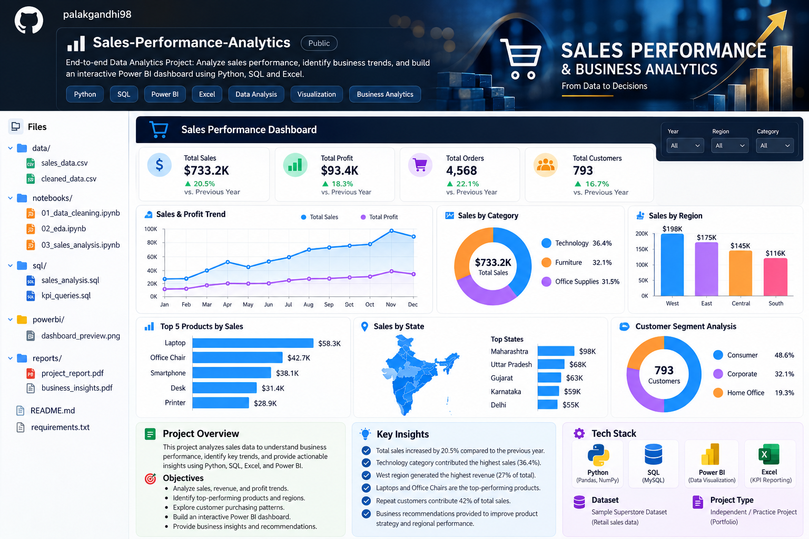

# Sales Performance & Business Analytics



An end-to-end data analytics portfolio project using
Python, SQL, Excel, and Power BI.

🎯 Project Objectives

- Analyze sales, revenue, and profit trends.
- Identify top-performing products and regions.
- Perform exploratory data analysis (EDA).
- Calculate key business performance indicators (KPIs).
- Create an interactive Power BI dashboard.
- Communicate findings through data visualizations and reports.

🛠️ Tech Stack

- Python: Pandas, NumPy, Matplotlib
- SQL: MySQL, aggregations, joins, KPI queries
- Visualization: Power BI
- Spreadsheet Analysis: Microsoft Excel

📁 Project Structure
```bash
Sales-Performance-Analytics/
├── data/
│   ├── sales_data.csv
│   └── cleaned_data.csv
├── images/
│   └── powerbi_dashboard_preview.png
├── notebooks/
│   └── 01_sales_data_cleaning_eda.ipynb
├── sql/
│   ├── 01_create_sales_table.sql
│   ├── 02_sales_analysis_queries.sql
│   └── README.md
├── powerbi/
│   ├── README.md
│   └── dax_measures.txt
├── README.md
└── requirements.txt
```

🔍 Analysis Performed

1. Data Cleaning
Inspect missing values and duplicate records.
Convert date and numeric columns to appropriate types.
Prepare data for analysis and reporting.

3. Exploratory Data Analysis
Examine sales and profit distributions.
Analyze monthly performance.
Compare product categories and regions.
Identify top products by sales.

5. SQL Business Analysis
Calculate total sales and profit.
Analyze category and regional performance.
Identify high-performing products.
Compare customer segments.
Calculate Average Order Value (AOV).
Explore month-over-month sales growth.

7. Power BI Dashboard
Planned visualizations include:
KPI cards for sales, profit, orders, and customers.
Monthly sales and profit trends.
Category and regional comparisons.
Top products and state-level analysis.
Customer segment breakdown.
Interactive slicers and filters.

📈 Key Business Questions
Which products generate the highest sales?
Which regions perform best?
How do sales and profits change over time?
Which customer segments contribute most to revenue?
Which products or categories have low or negative profitability?

🚀 How to Run
Clone or download this repository.
Install the required Python libraries.
Open the notebook in Jupyter Notebook or Google Colab.
Load the sample dataset from the data/ directory.
Run the notebook cells to perform analysis.
Execute the SQL scripts in MySQL after importing the dataset.
Use the dataset in Power BI Desktop to build the dashboard.

📌 Project Status
In Progress — data analysis, SQL queries, and dashboard development are being assembled into a complete portfolio project.

👩‍💻 Author
Palak Gandhi
GitHub: palakgandhi98
LinkedIn: palakgandhi98

⚠️ Dataset Disclaimer
This project uses synthetic sample sales data for educational and portfolio purposes. Dashboard figures and business findings will be reported only after they have been calculated and validated against the dataset.
